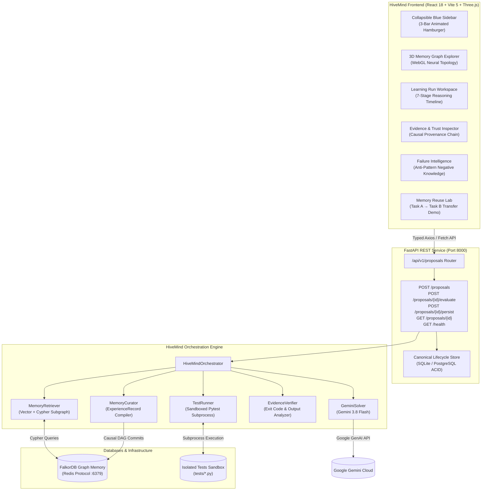
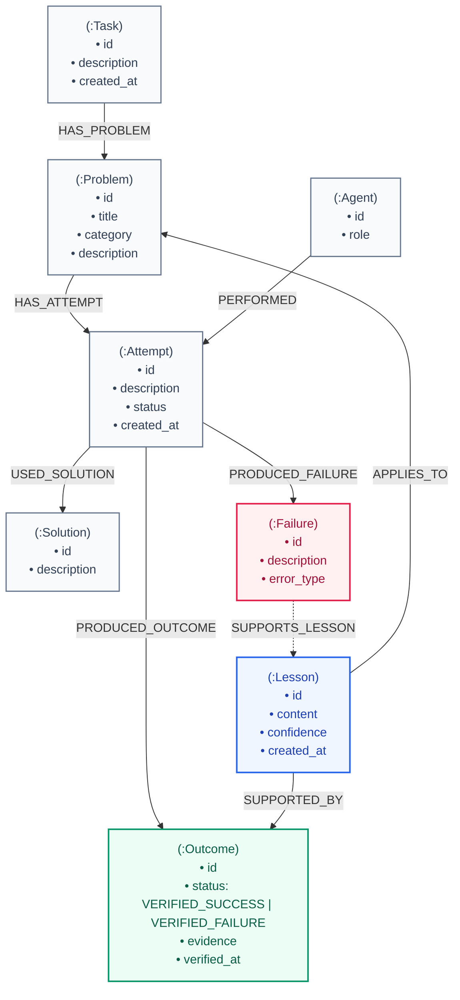
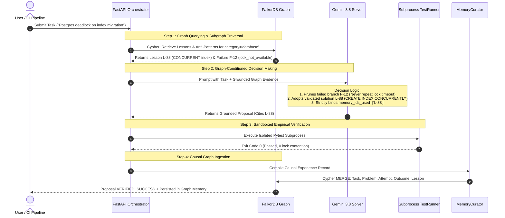

# HiveMind — Evidence-Backed Collective Graph Memory for AI Coding Agents

[](https://fastapi.tiangolo.com)
[](https://react.dev)
[](https://threejs.org)
[](https://falkordb.com)
[](https://ai.google.dev)
[](https://python.org)
[](https://typescriptlang.org)
[](https://tailwindcss.com)

HiveMind is an AI-powered collective memory and verification system for coding agents. Unlike conventional LLM coding assistants that operate in an ephemeral loop—forgetting past failures, hallucinating fixes, and repeatedly falling into the same concurrency bugs—HiveMind enforces a complete, empirical learning lifecycle:

> **Retrieve Prior Experience** ➔ **Diagnose & Propose** ➔ **Execute Sandbox Tests** ➔ **Verify Evidence** ➔ **Persist to Graph DAG** ➔ **Reuse on Future Tasks**

The system pairs a **FastAPI backend** and **FalkorDB Graph Database** with an interactive **React 3D Workbench** featuring an animated blue sidebar navigation, 3D WebGL memory topology, agent reasoning timeline, evidence provenance inspector, and cross-task memory transfer demonstration.

---

## Architecture Overview



---

## 🗺️ FalkorDB Graph Map & Schema

In HiveMind, memory is not a flat list of text documents or lossy vector embeddings. It is an immutable, causal directed acyclic graph (DAG) in **FalkorDB** containing 8 strongly-typed node classes connected through semantic relationships.

### Graph Topology & Relationships



### Node Entity & Property Reference

| Node Label | Key Properties | Role in Memory Lifecycle |
|---|---|---|
| `(:Task)` | `id`, `description`, `created_at` | Root boundary representing the user-requested engineering objective. |
| `(:Problem)` | `id`, `title`, `category`, `description` | Formal domain classification (e.g., `concurrency`, `migrations`, `database`). |
| `(:Agent)` | `id`, `role` | Identity and persona of the executing agent (e.g. `Investigator`, `Solver`). |
| `(:Attempt)` | `id`, `description`, `status`, `created_at` | An empirical attempt containing a generated code patch or strategy. |
| `(:Solution)` | `id`, `description` | The concrete solution payload (patch, configuration, or migration SQL). |
| `(:Failure)` | `id`, `description`, `error_type` | Captured negative evidence (e.g. PostgreSQL `lock_not_available`, error code `54000`). |
| `(:Outcome)` | `id`, `status`, `evidence`, `verified_at` | Deterministic verification result (`VERIFIED_SUCCESS` / `VERIFIED_FAILURE`) with stdout/stderr. |
| `(:Lesson)` | `id`, `content`, `confidence`, `created_at` | High-order engineering heuristic synthesized only from verified empirical outcomes. |

### Semantic Relationships

- `(:Task)-[:HAS_PROBLEM]->(:Problem)`: Scopes the core failure or obstacle to a domain problem.
- `(:Problem)-[:HAS_ATTEMPT]->(:Attempt)`: Links every trial and iteration attempted on this problem.
- `(:Agent)-[:PERFORMED]->(:Attempt)`: Attributes work to the executing agent.
- `(:Attempt)-[:USED_SOLUTION]->(:Solution)`: Records the specific solution patch executed.
- `(:Attempt)-[:PRODUCED_FAILURE]->(:Failure)`: Links to structured failure symptoms and error codes.
- `(:Attempt)-[:PRODUCED_OUTCOME]->(:Outcome)`: Binds to deterministic test runner output and status.
- `(:Lesson)-[:APPLIES_TO]->(:Problem)`: Indexes lessons for cross-task semantic retrieval.
- `(:Lesson)-[:SUPPORTED_BY]->(:Outcome)`: **Integrity guarantee**: Lessons can *only* exist when backed by a verified outcome.
- `(:Failure)-[:SUPPORTS_LESSON]->(:Lesson)`: Links negative knowledge directly to derived prevention rules.

---

### How the Agent Queries FalkorDB

HiveMind's agent subsystem queries FalkorDB at three crucial stages using Cypher:

#### 1. Contextual Experience Retrieval Query
When a new task is submitted, `Investigator` / `MemoryRetriever` queries FalkorDB to find relevant past lessons, positive outcomes, and counter-example failures:

```cypher
MATCH (l:Lesson)-[:APPLIES_TO]->(p:Problem)
MATCH (l)-[:SUPPORTED_BY]->(o:Outcome)
WHERE o.status IN ['VERIFIED_SUCCESS', 'VERIFIED_FAILURE']
OPTIONAL MATCH (a:Attempt)-[:PRODUCED_OUTCOME]->(o)
OPTIONAL MATCH (a)-[:PRODUCED_FAILURE]->(f:Failure)
RETURN DISTINCT
    l.id, l.content, l.confidence,
    p.id, p.title, p.description, p.category,
    o.id, o.status, o.evidence,
    a.id, a.description,
    f.description, f.error_type
```

#### 2. Deep Problem History & Anti-Pattern Traversal Query
When diagnosing recurring regressions, the agent queries the full causal lineage of previous attempts and failures:

```cypher
MATCH (p:Problem {id: $problem_id})-[:HAS_ATTEMPT]->(a:Attempt)
OPTIONAL MATCH (a)-[:PRODUCED_FAILURE]->(f:Failure)
OPTIONAL MATCH (a)-[:PRODUCED_OUTCOME]->(o:Outcome)
RETURN p.id, p.title,
       a.id, a.description, a.status,
       f.id, f.description, f.error_type,
       o.id, o.status, o.evidence
ORDER BY a.created_at ASC
```

#### 3. Causal DAG Mutation Query (Atomic Ingestion)
When tests succeed (or confirm a negative pattern), `MemoryCurator` commits the verified outcome and lesson atomically into FalkorDB without overwriting historical records:

```cypher
MERGE (l:Lesson {id: $lesson_id})
SET l.content = $content,
    l.confidence = $confidence,
    l.created_at = $created_at
WITH l
MATCH (p:Problem {id: $problem_id})
MATCH (o:Outcome {id: $outcome_id})
MERGE (l)-[:APPLIES_TO]->(p)
MERGE (l)-[:SUPPORTED_BY]->(o)
```

---

## 🛡️ How FalkorDB Drives Agent Decisions (The Graph in Action)

FalkorDB is not a passive logging database in HiveMind—**it is the central decision-making engine that dictates every agent action**. Without the graph, an LLM agent operates in an ephemeral vacuum, repeating past deadlocks and hallucinating non-viable fixes. With FalkorDB, the agent acts as an empirical, self-improving reasoning system.

### Graph-Driven Decision Loop



### Where the Agent's Decisions Come From the Graph

Every critical decision made by the HiveMind agent originates directly from FalkorDB graph nodes and traversals:

#### 1. Positive Solution Grounding (What To Do)
- **Graph Source**: `(:Lesson)-[:SUPPORTED_BY]->(:Outcome {status: "VERIFIED_SUCCESS"})`
- **Agent Decision**: When FalkorDB returns a verified lesson (e.g., *"When adding a unique index to a high-concurrency PostgreSQL table, use `CREATE UNIQUE INDEX CONCURRENTLY` with statement timeouts"*), the solver agent grounds its `proposed_fix` directly on the verified lesson content and references `memory_ids_used: ["lesson-xxx"]`.
- **Integrity Enforcement**: The solver prompt strictly restricts `memory_ids_used` to lesson IDs retrieved from FalkorDB; inventing or modifying memory IDs is rejected at schema validation.

#### 2. Negative Knowledge Pruning (What NOT To Do)
- **Graph Source**: `(:Attempt)-[:PRODUCED_FAILURE]->(:Failure {error_type: "54000"})`
- **Agent Decision**: Standard LLMs repeatedly attempt naive `ALTER TABLE ADD CONSTRAINT UNIQUE` because it is syntactically concise. FalkorDB contains the negative knowledge showing that this causes an `AccessExclusiveLock` timeout (`54000: lock_not_available`). The agent's decision engine identifies the past failure and **explicitly prunes that strategy** from its search space before generating code.

#### 3. Strict Verification & Anti-Hallucination Integrity
- **Graph Source**: `(:Outcome {evidence: "..."})`
- **Agent Decision**: The agent is structurally prohibited from self-declaring success. An outcome node can only be written to FalkorDB when the sandboxed test runner returns a deterministic exit code (`0` for success, non-zero for failure). The agent's subsequent decisions are thus grounded exclusively in empirical proof rather than LLM confidence.

#### 4. Cross-Task Knowledge Transfer (Task A → Task B)
- **Task A (First Encounter)**: Agent encounters an unindexed migration deadlock. Initial naive solution fails (`VERIFIED_FAILURE` logged). Agent explores alternative, verifies `CONCURRENTLY` via pytest (`VERIFIED_SUCCESS`), and commits `Lesson L-88` to FalkorDB.
- **Task B (Subsequent Similar Task)**: A new task arrives: *"Add unique constraint on customer_email table under heavy production traffic"*.
  - FalkorDB instantly serves `Lesson L-88`.
  - The agent generates the correct non-blocking migration on the **first attempt** with zero failed test cycles.
  - FalkorDB directly saved compute time, prevented database outages, and eliminated human debugging intervention.

---

## Distinctive Workbench Features

### 1. Animated Blue Sidebar Navigation
- **Deep Blue Palette**: Styled with `#1E3A8A` primary navy, `#172554` secondary slate-blue, and `#60A5FA` electric blue highlights.
- **Animated 3-Bar Hamburger**: Smoothly transforms into a close `X` icon on toggle with micro-animations.
- **Dual-Mode Desktop & Mobile**: Collapses into a sleek 72px icon rail on desktop with floating tooltips, and slides over with a backdrop overlay on mobile.
- **Live Infrastructure Telemetry**: Real-time health indicators for FastAPI backend and FalkorDB connectivity.

### 2. Collective Memory Graph Explorer (3D WebGL)
- **Living Memory Topology**: Dark navy 3D canvas featuring a central glowing wireframe core, precessing orbital rings, floating typed nodes, and dynamic particle starfields.
- **Evidence-Based Color Encoding**:
  - <span style="color:#2563EB">●</span> **Blue**: Persistent Lessons & Knowledge Nodes
  - <span style="color:#059669">●</span> **Green**: Verified Success Outcomes (`VERIFIED_SUCCESS`)
  - <span style="color:#E11D48">●</span> **Red**: Verified Failures & Anti-Patterns (`VERIFIED_FAILURE`)
  - <span style="color:#D97706">●</span> **Amber**: Unverified Proposals & Active Tasks (`UNVERIFIED`)
- **HUD Controls**: Interactive drag, inertia damping, camera reset, pause/resume orbit, causal chain highlighting, and cluster filtering.

### 3. Agent Reasoning Timeline (Learning Run Workspace)
Tracks the complete autonomous lifecycle as a 7-stage connected timeline:
1. **Investigation Scoping**: Canonical task parameterization and input boundaries.
2. **Memory Retrieval**: FalkorDB vector and Cypher traversal for relevant historical lessons.
3. **Solution Generation**: Gemini solver diagnostic analysis and patch synthesizer.
4. **Sandboxed Fixture Binding**: Restricting test execution strictly within `tests/`.
5. **Subprocess Pytest Execution**: Isolated pytest subprocess runner capturing stdout/stderr.
6. **Empirical Verification Classification**: Status strictly determined by subprocess exit codes.
7. **Graph Memory Persistence**: Inserting verified nodes into FalkorDB with grounded Cypher queries.

### 4. Evidence & Trust Provenance Inspector
Answers the core engineering question: **"Why should I trust this lesson?"**
- Visualizes the unbroken 5-stage causal provenance chain: `Task → Proposal → Test Execution → Verification Outcome → Persisted Lesson`.
- **Anti-Hallucination Integrity Contract**: Client-side requests cannot manually claim success or alter test evidence; status is derived solely from the backend test runner.

### 5. Failure Intelligence & Negative Knowledge
- Captures counter-examples and failed attempts (e.g., standard blocking index builds triggering PostgreSQL error `54000: lock_not_available`).
- Preserves negative knowledge to prune known-bad solution branches before code is committed.

### 6. Learning Transfer Demonstration (Memory Reuse Lab)
- Side-by-side benchmark demonstrating collective learning:
  - **Task A (Seed Experience)**: Generates a fix for a migration deadlock, runs pytest, and commits `Lesson L-88` to FalkorDB.
  - **Task B (Future Similar Task)**: Submits a related problem, performs live retrieval against FalkorDB, and proves that the newly created proposal is directly informed by Task A's lesson!

---

## Quick Start & Setup

### 1. Prerequisites
- **Python**: 3.11+
- **Node.js**: 18+ & **npm**
- **Docker**: For running FalkorDB and PostgreSQL

### 2. Start Database Services
```bash
# Start FalkorDB on port 6379 and PostgreSQL on port 5433
docker-compose up -d falkordb postgres-test
```

### 3. Backend Setup
```bash
# Activate virtual environment
# Windows:
.venv\Scripts\activate
# Linux/macOS:
# source .venv/bin/activate

# Install dependencies
pip install -r requirements.txt

# Configure environment variables in project-root .env:
# GEMINI_API_KEY=your_key_here
# GEMINI_MODEL=gemini-3.8-flash
# FALKORDB_HOST=localhost
# FALKORDB_PORT=6379

# Run FastAPI backend server (port 8000)
python -m uvicorn backend.main:app --host 127.0.0.1 --port 8000 --reload
```

Verify backend health:
```bash
curl http://127.0.0.1:8000/api/v1/health
# {"status":"healthy","service":"HiveMind API","database_connected":true,"version":"1.0.0"}
```

### 4. Frontend Setup
```bash
# Navigate to frontend directory
cd frontend

# Install npm dependencies
npm install

# Start Vite dev server on port 3000
npm run dev -- --host 127.0.0.1 --port 3000
```
Open **[http://127.0.0.1:3000](http://127.0.0.1:3000)** in your browser.

---

## Automated Verification & Test Suite

HiveMind features an automated test suite verifying deterministic verification rules, graph integrity, and API lifecycle:

```bash
# Run all 58 backend tests (including SQLite/Postgres lifecycle persistence and API tests)
pytest -v

# Run deterministic learning loop verification demo (zero external API cost)
python app/ai/demo_learning_loop.py

# Test frontend production build
cd frontend && npm run build
```

---

## REST API Specification

| Method | Endpoint | Description |
|---|---|---|
| `GET` | `/api/v1/health` | Health check verifying API and FalkorDB connectivity. |
| `POST` | `/api/v1/proposals` | Submit a task to retrieve memory and generate a fix proposal (`UNVERIFIED`). |
| `POST` | `/api/v1/proposals/{id}/evaluate` | Run an isolated pytest fixture under `tests/` and classify evidence. |
| `POST` | `/api/v1/proposals/{id}/persist` | Ingest verified outcome and reusable lesson into FalkorDB DAG. |
| `GET` | `/api/v1/proposals/{id}` | Retrieve canonical proposal record. |
| `GET` | `/api/v1/proposals/{id}/evaluation` | Retrieve evaluation execution evidence. |
| `GET` | `/api/v1/proposals/{id}/persisted` | Retrieve persisted lesson node metadata. |

---

## Tech Stack Summary

- **Frontend**: React 18, Vite 5, TypeScript, Tailwind CSS, Three.js, Lucide React.
- **Backend**: FastAPI, Uvicorn, Pydantic v2, Python 3.11+.
- **AI Core**: Google GenAI SDK (Gemini 3.8 Flash), Sentence-Transformers Embeddings.
- **Graph Database**: FalkorDB (Cypher Query Language over Redis protocol).
- **Persistence**: SQLite (development) & PostgreSQL (production migration tested).
- **Execution Sandbox**: Subprocess-isolated Pytest TestRunner with strict directory whitelisting.

---

## License

Apache License 2.0. Built for the Google DeepMind & Agentic AI Collective Intelligence Challenge.