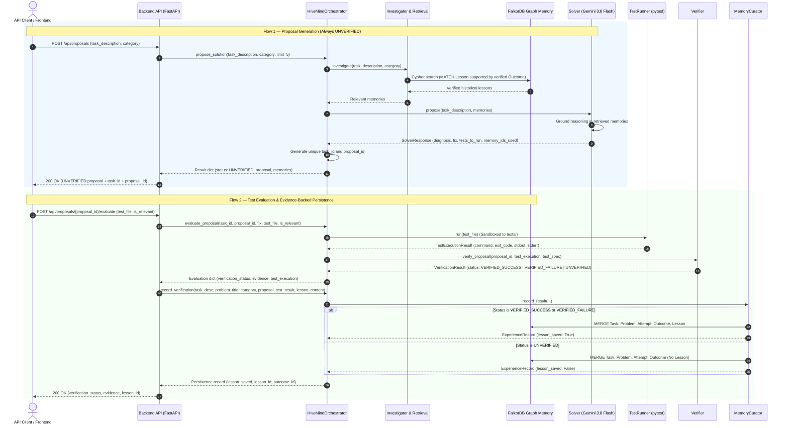

# HiveMind — Backend Integration Guide
## AI Reasoning, Verification Pipeline & FalkorDB Graph Memory

This guide documents how the HiveMind backend developer should integrate Person 1's **AI + Graph Memory** module (`app/ai` and `app/memory`) into the HiveMind backend service.

---

## 1. Purpose and Architecture

HiveMind provides evidence-backed collective memory for coding agents. It separates speculative LLM generation from empirical validation:

1. **AI Orchestration (`app/ai`)**: Coordinates graph memory retrieval, solution generation via Gemini, controlled test execution via pytest, and outcome verification.
2. **Graph Memory (`app/memory`)**: Stores interconnected entities (`Task`, `Problem`, `Attempt`, `Solution`, `Failure`, `Outcome`, `Lesson`) in **FalkorDB**.
3. **Evidence Gate**: A proposal remains `UNVERIFIED` until an explicitly selected test fixture is executed and confirmed by the `Verifier`. Only verified outcomes can produce persistent, reusable lessons.

### Architectural Boundary

| Component | Responsibility | Ownership |
| :--- | :--- | :--- |
| **Backend API Layer (`backend/`)** | HTTP endpoints, routing, authentication, request validation, serialization | **Backend Developer** |
| **Orchestration Layer (`app/ai/orchestrator.py`)** | Single public entry point coordinating agents and memory | **AI / Memory (Person 1)** |
| **Solver Agent (`app/ai/solver.py`)** | Calls Gemini with retrieved memory context; outputs structured proposals | **AI / Memory (Person 1)** |
| **Test Runner (`app/ai/test_runner.py`)** | Executes pytest subprocesses strictly inside `tests/` directory | **AI / Memory (Person 1)** |
| **Verifier Agent (`app/ai/verifier.py`)** | Evaluates test exit codes and enforces proposal-to-test relevance | **AI / Memory (Person 1)** |
| **Memory Curator (`app/ai/memory_curator.py`)** | Gated persistence: stores verified evidence & lessons in FalkorDB | **AI / Memory (Person 1)** |
| **Graph Repository (`app/memory/`)** | Cypher queries, FalkorDB graph schema, and token similarity retrieval | **AI / Memory (Person 1)** |

### Workflow Sequence Diagram



---

## 2. Prerequisites & Environment

### Python Environment
- Python 3.11+ (repository virtualenv: `.venv`).
- Key dependencies already installed: `falkordb`, `google-genai`, `pydantic`, `pytest`, `python-dotenv`.

### Environment Variables
Configured in project-root `.env`:

| Variable | Required | Default | Description |
| :--- | :---: | :---: | :--- |
| `GEMINI_API_KEY` | **Yes** (for live Solver) | None | Google Gemini API Key. Must be non-empty for `Solver.propose()`. |
| `GEMINI_MODEL` | No | `gemini-3.8-flash` | Gemini model name used by `gemini_client.py`. |
| `FALKORDB_HOST` | No | `localhost` | FalkorDB server host. |
| `FALKORDB_PORT` | No | `6379` | FalkorDB server port. |

### FalkorDB Server
FalkorDB must be running prior to starting the backend:
```bash
docker-compose up -d falkordb
```
Graph name used by default is `hivemind`.

### Working Directory & Test Directory Sandbox
- The backend process **must execute with the project root (`d:\HiveMind`) as the working directory**.
- `TestRunner` enforces a strict sandbox: **only test files located inside `tests/` relative to project root are permitted**. Any path outside `tests/` raises `ValueError`.

---

## 3. Public Interface Reference

The backend should import and instantiate `HiveMindOrchestrator` exclusively:

```python
from app.ai.orchestrator import HiveMindOrchestrator

orchestrator = HiveMindOrchestrator()
```

Do not directly import internal agents (`Investigator`, `Solver`, `Verifier`, `MemoryCurator`, `TestRunner`, `GraphMemoryRepository`) into API route handlers.

---

### Method 1: `propose_solution`

```python
def propose_solution(
    self,
    task_description: str,
    category: str | None = None,
    limit: int = 5,
) -> dict[str, Any]
```

- **Purpose**: Retrieves relevant historical lessons from FalkorDB and generates a structured solution proposal via Gemini.
- **Parameters**:
  - `task_description` (`str`): Non-empty description of the engineering issue. Whitespace-only string raises `ValueError`.
  - `category` (`str | None`, optional): Domain filter (e.g. `"database_migration"`, `"caching"`, `"networking"`). If provided, limits retrieval to matching problems or grants a ranking bonus.
  - `limit` (`int`, optional, default `5`): Maximum lessons to retrieve (must be between 1 and 10).
- **Side Effects**:
  - **FalkorDB**: Read-only Cypher query searching lessons supported by verified outcomes.
  - **Gemini**: Calls Gemini API with structured prompt and response schema (`SolverResponse`).
- **Returns** (`dict[str, Any]`):
  ```python
  {
      "task_id": str,               # Generated unique ID: "task-<uuid4_hex>"
      "proposal_id": str,           # Generated unique ID: "proposal-<uuid4_hex>"
      "task_description": str,      # Echoes input task description
      "proposed_fix": str,          # proposal.proposed_fix text
      "memories": list[dict],       # List of retrieved historical lessons
      "memory_count": int,          # Count of retrieved lessons (0 to limit)
      "proposal": SolverResponse,   # Pydantic model with detailed proposal
      "verification_status": "UNVERIFIED" # ALWAYS UNVERIFIED at creation
  }
  ```
  **`SolverResponse` Attributes**:
  - `proposal.proposal_id` (`str`): Matches the generated `proposal_id`.
  - `proposal.diagnosis` (`str`): Analysis of root cause.
  - `proposal.proposed_fix` (`str`): Concrete fix instructions.
  - `proposal.reasoning` (`str`): Explanation, citing past lessons if relevant.
  - `proposal.tests_to_run` (`list[str]`): Suggested test verification steps.
  - `proposal.memory_ids_used` (`list[str]`): IDs of retrieved lessons utilized.
  - `proposal.risks` (`list[str]`): Potential uncertainties and risks.
- **Errors Raised**:
  - `ValueError`: If `task_description` is blank or `limit` is not between 1 and 10.
  - `RuntimeError`: If `GEMINI_API_KEY` is missing or Gemini returns empty text.
  - `google.genai.errors.ServerError`: If Gemini server fails after 3 exponential backoff retries.
  - `redis.exceptions.ConnectionError`: If FalkorDB cannot be reached.

---

### Method 2: `evaluate_proposal`

```python
def evaluate_proposal(
    self,
    task_id: str,
    proposal_id: str,
    task_description: str,
    proposed_fix: str,
    test_file: str,
    is_relevant: bool = True,
    test_description: str = "",
) -> dict[str, Any]
```

- **Purpose**: Runs a permitted test file via pytest in a subprocess, binds the execution result to the designated proposal, and verifies outcome status.
- **Parameters**:
  - `task_id` (`str`): Task ID returned by `propose_solution()`.
  - `proposal_id` (`str`): Proposal ID returned by `propose_solution()`.
  - `task_description` (`str`): The task description.
  - `proposed_fix` (`str`): Proposed fix text from `propose_solution()`.
  - `test_file` (`str`): Relative path to test file under `tests/` (e.g., `"tests/test_migration_fixture.py"`).
  - `is_relevant` (`bool`, default `True`): Must be `True` to allow verification. If `False`, the verifier forces status to `UNVERIFIED`.
  - `test_description` (`str`, optional): Descriptive context explaining why this test applies.
- **Side Effects**:
  - Executes `python -m pytest <test_file> -q` in a subprocess (timeout: 60s).
  - Does **not** modify FalkorDB.
- **Returns** (`dict[str, Any]`):
  ```python
  {
      "task_id": str,
      "proposal_id": str,
      "task_description": str,
      "proposed_fix": str,
      "test_specification": TestSpecification,
      "selected_test_file": str,
      "test_execution": TestExecutionResult, # command, exit_code, tests_executed, stdout, stderr
      "verification": VerificationResult,
      "verification_status": str,            # "VERIFIED_SUCCESS" | "VERIFIED_FAILURE" | "UNVERIFIED"
      "evidence": str,                       # Structured multi-line evidence string
  }
  ```
- **Verification Status Rules**:
  - `VERIFIED_SUCCESS`: Tests executed, exit code `0`, `is_relevant=True`, test file matches.
  - `VERIFIED_FAILURE`: Tests executed, exit code $\neq 0$, `is_relevant=True`, test file matches.
  - `UNVERIFIED`: Test timed out, test execution unconfirmed, `is_relevant=False`, test file mismatch, or missing test specification.
- **Errors Raised**:
  - `ValueError`: If `test_file` is located outside `tests/` or does not end with `.py`.
  - `FileNotFoundError`: If `test_file` does not exist on disk.

---

### Method 3: `record_verification`

```python
def record_verification(
    self,
    task_description: str,
    problem_title: str,
    category: str,
    proposal: Any,
    test_result: TestExecutionResult,
    lesson_content: str | None = None,
    test_spec: TestSpecification | None = None,
    task_id: str | None = None,
    proposal_id: str | None = None,
) -> dict[str, Any]
```

- **Purpose**: Persists the evaluated outcome and verification evidence into FalkorDB graph memory. Creates a reusable `Lesson` node **if and only if** the verification status is `VERIFIED_SUCCESS` or `VERIFIED_FAILURE` and valid `lesson_content` is provided.
- **Parameters**:
  - `task_description` (`str`): Non-empty task description.
  - `problem_title` (`str`): Non-empty problem title for graph memory indexing.
  - `category` (`str`): Non-empty problem category.
  - `proposal` (`SolverResponse` or `str`): The proposal object or fix string.
  - `test_result` (`TestExecutionResult`): The execution result obtained from `evaluate_proposal()["test_execution"]`.
  - `lesson_content` (`str | None`, optional): Reusable insight learned. **Required** if status is `VERIFIED_SUCCESS` or `VERIFIED_FAILURE`. Cannot be blank.
  - `test_spec` (`TestSpecification | None`, optional): The specification obtained from `evaluate_proposal()["test_specification"]`.
  - `task_id` (`str | None`, optional): Reuses existing task ID if provided.
  - `proposal_id` (`str | None`, optional): Reuses existing proposal ID if provided.
- **Side Effects**:
  - **FalkorDB Write**: Executes `MERGE` queries persisting `Task`, `Problem`, `Attempt`, `Outcome`, and optionally `Lesson`, `Solution`, `Failure`.
- **Returns** (`dict[str, Any]`):
  ```python
  {
      "task_id": str,
      "proposal_id": str,
      "verification_status": str,     # "VERIFIED_SUCCESS" | "VERIFIED_FAILURE" | "UNVERIFIED"
      "verification_evidence": str,   # Stored evidence audit trail
      "lesson_saved": bool,           # True if Lesson node was created in FalkorDB
      "lesson_id": str | None,        # "lesson-<uuid4_hex>" if saved, else None
      "outcome_id": str,              # "outcome-attempt-<proposal_id>"
  }
  ```
- **Errors Raised**:
  - `ValueError`: If required fields are blank, or if `lesson_content` is missing for a verified outcome, or if an attempt status does not match outcome status.

---

## 4. Backend Request & Response Mapping

The backend developer can map REST API endpoints to the orchestrator methods. 

> [!NOTE]
> The HTTP paths and schemas below are **illustrative architectural designs** for the future backend. Person 1 has **not** implemented these endpoints.

### Illustrative Endpoint 1: Generate Proposal
- **Route**: `POST /api/v1/proposals`
- **Request Body**:
  ```json
  {
    "task_description": "Database transaction deadlock when creating index on active orders table during migration",
    "category": "database_migration",
    "limit": 5
  }
  ```
- **Internal Call**:
  ```python
  result = orchestrator.propose_solution(
      task_description=payload["task_description"],
      category=payload.get("category"),
      limit=payload.get("limit", 5)
  )
  ```
- **API Response (200 OK)**:
  ```json
  {
    "task_id": "task-ba7a18b709994e25851f048e353e0412",
    "proposal_id": "proposal-5919086a068545d58bf5dcd38dc19e21",
    "status": "UNVERIFIED",
    "diagnosis": "Table locks during index creation cause deadlocks on high-traffic tables.",
    "proposed_fix": "Create indexes concurrently using non-blocking schema statements.",
    "reasoning": "Informed by previous verified experience: concurrent index builds prevent table-level exclusive locks.",
    "tests_to_run": ["tests/test_migration_fixture.py"],
    "memory_ids_used": ["lesson-cb373398572b420289aa6d54ed6b612f"],
    "retrieved_memories_count": 1,
    "risks": ["Temporary background I/O increase during non-blocking index build."]
  }
  ```

---

### Illustrative Endpoint 2: Evaluate Proposal
- **Route**: `POST /api/v1/proposals/{proposal_id}/evaluate`
- **Request Body**:
  ```json
  {
    "task_id": "task-ba7a18b709994e25851f048e353e0412",
    "task_description": "Database transaction deadlock when creating index on active orders table during migration",
    "proposed_fix": "Create indexes concurrently using non-blocking schema statements.",
    "test_file": "tests/test_migration_fixture.py",
    "is_relevant": true,
    "test_description": "Verify concurrent index migration eliminates deadlocks"
  }
  ```
- **Internal Call**:
  ```python
  eval_result = orchestrator.evaluate_proposal(
      task_id=payload["task_id"],
      proposal_id=proposal_id,
      task_description=payload["task_description"],
      proposed_fix=payload["proposed_fix"],
      test_file=payload["test_file"],
      is_relevant=payload.get("is_relevant", True),
      test_description=payload.get("test_description", "")
  )
  ```
- **API Response (200 OK)**:
  ```json
  {
    "proposal_id": "proposal-5919086a068545d58bf5dcd38dc19e21",
    "verification_status": "VERIFIED_SUCCESS",
    "tests_executed": true,
    "exit_code": 0,
    "evidence": "Test command: python -m pytest tests/test_migration_fixture.py -q\nTests executed: True\nExit code: 0\nProposal ID: proposal-5919086a068545d58bf5dcd38dc19e21\nDesignated test file: tests/test_migration_fixture.py\nTest relevance: True\nVerification status: VERIFIED_SUCCESS"
  }
  ```

---

### Illustrative Endpoint 3: Persist Verification Outcome
- **Route**: `POST /api/v1/proposals/{proposal_id}/persist`
- **Request Body**:
  ```json
  {
    "task_id": "task-ba7a18b709994e25851f048e353e0412",
    "task_description": "Database transaction deadlock when creating index on active orders table during migration",
    "problem_title": "Index creation migration deadlock",
    "category": "database_migration",
    "lesson_content": "When adding an index to tables under active load during schema migrations, execute concurrent index builds to prevent deadlock."
  }
  ```
- **Internal Call**:
  ```python
  record = orchestrator.record_verification(
      task_description=payload["task_description"],
      problem_title=payload["problem_title"],
      category=payload["category"],
      proposal=eval_result["proposed_fix"],
      test_result=eval_result["test_execution"],
      lesson_content=payload.get("lesson_content"),
      test_spec=eval_result["test_specification"],
      task_id=payload["task_id"],
      proposal_id=proposal_id
  )
  ```
- **API Response (200 OK)**:
  ```json
  {
    "proposal_id": "proposal-5919086a068545d58bf5dcd38dc19e21",
    "verification_status": "VERIFIED_SUCCESS",
    "lesson_saved": true,
    "lesson_id": "lesson-c9f9ca68a8934414be6cc85600d39da9",
    "outcome_id": "outcome-attempt-proposal-5919086a068545d58bf5dcd38dc19e21"
  }
  ```

---

## 5. End-to-End Integration Example

Below is a self-contained Python script demonstrating how a backend service should orchestrate the 3 stages:

```python
"""
backend_service_example.py
Demonstrates the exact call sequence a backend service uses to interface with HiveMind.
"""

from app.ai.orchestrator import HiveMindOrchestrator


def handle_engineering_task():
    # 1. Instantiate the orchestrator
    orchestrator = HiveMindOrchestrator()

    # 2. Step 1: Submit task and generate initial UNVERIFIED proposal
    task_desc = "Database transaction deadlock when creating index on active orders table"
    category = "database_migration"

    proposal_data = orchestrator.propose_solution(
        task_description=task_desc,
        category=category,
        limit=5,
    )

    task_id = proposal_data["task_id"]
    proposal_id = proposal_data["proposal_id"]
    proposal = proposal_data["proposal"]

    print(f"Generated Proposal ID: {proposal_id}")
    print(f"Initial Status:        {proposal_data['verification_status']}")  # UNVERIFIED
    print(f"Retrieved Lessons:     {proposal_data['memory_count']}")

    # 3. Step 2: Evaluate the proposal with an explicitly selected test fixture
    # The backend selects tests from tests/ and asserts relevance
    test_file = "tests/test_migration_fixture.py"

    eval_result = orchestrator.evaluate_proposal(
        task_id=task_id,
        proposal_id=proposal_id,
        task_description=task_desc,
        proposed_fix=proposal.proposed_fix,
        test_file=test_file,
        is_relevant=True,
        test_description="Verify concurrent index statement eliminates deadlocks",
    )

    print(f"Test Execution Exit Code: {eval_result['test_execution'].exit_code}")
    print(f"Verification Status:      {eval_result['verification_status']}")

    # 4. Step 3: Persist verified outcome and save reusable lesson to FalkorDB
    lesson_text = (
        "When creating indexes on active tables during migration, "
        "execute concurrent index builds to prevent deadlock."
    )

    record_result = orchestrator.record_verification(
        task_description=task_desc,
        problem_title="Index creation deadlock on orders table",
        category=category,
        proposal=proposal,
        test_result=eval_result["test_execution"],
        lesson_content=lesson_text,
        test_spec=eval_result["test_specification"],
        task_id=task_id,
        proposal_id=proposal_id,
    )

    print(f"Lesson Saved in Graph:    {record_result['lesson_saved']}")
    print(f"Persisted Lesson ID:      {record_result['lesson_id']}")
    print(f"Persisted Outcome ID:     {record_result['outcome_id']}")


if __name__ == "__main__":
    handle_engineering_task()
```

---

## 6. Verification and Evidence Integrity

The backend must respect these core verification rules:

1. **A Generated Proposal Is Never Verified by Default**:
   - `propose_solution()` strictly returns `verification_status="UNVERIFIED"`. The backend must never expose a newly generated proposal as "verified" or "safe" until `evaluate_proposal()` has been executed.
2. **Relevance Is Mandatory**:
   - The backend must never run a generic smoke test (e.g. `tests/test_runner_smoke.py`) and submit it with `is_relevant=True` for an unrelated engineering problem. If a test is not designed for that specific proposal, it must have `is_relevant=False`, which produces `UNVERIFIED`.
3. **No Lessons from Unverified Outcomes**:
   - If `verification_status` is `UNVERIFIED`, `record_verification` will **not** create a `Lesson` node in FalkorDB (`lesson_saved=False`, `lesson_id=None`). Attempting to bypass this raises `ValueError` in schema validation.
4. **Anti-Hallucination Invariant**:
   - The Solver strictly validates that any IDs in `proposal.memory_ids_used` exist in the retrieved memory package. If the model hallucinates an ID, a `ValueError` is raised. The backend should not suppress this error.
5. **No Autonomous Causal Claims**:
   - A passing test confirms that the specific test command exited with code 0 on the designated fixture. The backend should communicate that the solution passed verification tests, rather than claiming a mathematically proven guarantee of correctness for all arbitrary code.

---

## 7. Error Handling & API Guidance

| Scenario | Exception Raised | Recommended HTTP Status | Recommended API Action |
| :--- | :--- | :---: | :--- |
| Empty `task_description` or invalid `limit` | `ValueError` | `400 Bad Request` | Return validation error message to client. |
| Test file outside `tests/` directory | `ValueError` | `403 Forbidden` | Reject unauthorized test path. |
| Test file does not exist | `FileNotFoundError` | `404 Not Found` | Return missing test fixture error. |
| Test execution times out (>60s) | Handled internally | `200 OK` | `evaluate_proposal` returns `UNVERIFIED` with timeout details in evidence. |
| Gemini API unavailable / 503 spike | `google.genai.errors.ServerError` | `503 Service Unavailable` | Return retryable error header (`Retry-After: 5`). |
| FalkorDB connection error | `redis.exceptions.ConnectionError` | `502 Bad Gateway` | Alert operator; database container down. |
| Missing or unverified lesson save | `ValueError` | `422 Unprocessable Entity` | Check verification status and lesson content. |

> [!CAUTION]
> Never catch exceptions to artificially return a `VERIFIED_SUCCESS` status. If an exception occurs, bubble it up as an error response.

---

## 8. Concurrency & Persistence Considerations

### Multi-Query Cypher Statements
`GraphMemoryRepository.save_experience()` runs multiple discrete Cypher queries (`Task`, `Problem`, `Attempt`, `Outcome`, `Lesson`).

- **Atomicity Note**: FalkorDB Cypher transactions are executed per statement. In the rare event of a process kill midway through, partial nodes (e.g. `Task` without `Attempt`) could exist.
- **Idempotency**: All write operations use `MERGE (node {id: $id})` and `MERGE (a)-[:REL]->(b)`. Retrying `record_verification()` with the same `proposal_id` and `task_id` safely completes missing links without duplicating nodes.
- **Visibility Gate**: Retrieval queries require an inner `MATCH (l:Lesson)-[:SUPPORTED_BY]->(o:Outcome)` where `o.status IN ['VERIFIED_SUCCESS', 'VERIFIED_FAILURE']`. A partial or unverified write **can never expose an incomplete lesson in retrieval**.
- **Backend Concurrency Recommendation**:
  - Process verification and persistence sequentially per task/proposal.
  - Do not dispatch parallel concurrent writes targeting the exact same `proposal_id`.

---

## 9. Testing the Integration

The backend developer should use these commands to validate the integration:

```bash
# 1. Run deterministic pytest suite (16 tests, 0 live Gemini cost)
.venv\Scripts\python.exe -m pytest -v

# 2. Run cross-task learning loop demo
.venv\Scripts\python.exe app/ai/demo_learning_loop.py

# 3. Run proposal verification unit scenarios
.venv\Scripts\python.exe app/ai/test_proposal_verification.py

# 4. Run end-to-end learning test
.venv\Scripts\python.exe app/ai/test_end_to_end_learning.py

# 5. Run live Gemini provider tests (requires GEMINI_API_KEY)
.venv\Scripts\python.exe -m app.ai.test_gemini
.venv\Scripts\python.exe -m app.ai.test_propose_workflow
```

---

## 10. Integration Checklist & Ownership Boundary

### Already Implemented by Person 1 (AI + Graph Memory)
- [x] FalkorDB graph schema and repository (`app/memory/schema.py`, `graph_repository.py`).
- [x] Memory retrieval with token similarity, category bonus, and deduplication (`app/memory/retrieval.py`).
- [x] Gemini client integration with exponential backoff retry (`app/ai/gemini_client.py`).
- [x] Solver agent with structured output and anti-hallucination validation (`app/ai/solver.py`).
- [x] TestRunner with sandbox enforcement restricted to `tests/` (`app/ai/test_runner.py`).
- [x] Verifier agent with proposal association and evidence formatting (`app/ai/verifier.py`).
- [x] MemoryCurator with strict evidence validation rules (`app/ai/memory_curator.py`).
- [x] Single public orchestrator entry point (`app/ai/orchestrator.py`).
- [x] Deterministic 16-test regression suite (`tests/`, `pytest.ini`).

### Required from Future Backend Developer
- [ ] Create FastAPI application and configure CORS/middleware in `backend/`.
- [ ] Instantiate `HiveMindOrchestrator` within backend dependency injection or application lifespan.
- [ ] Implement API route handlers mapping client requests to orchestrator methods.
- [ ] Implement request validation models matching the expected inputs.
- [ ] Ensure test fixtures to be evaluated exist under `tests/`.
- [ ] Ensure `task_id` and `proposal_id` are preserved across proposal and verification calls.
- [ ] Return appropriate HTTP status codes without converting errors to `VERIFIED_SUCCESS`.

### Joint Integration Testing Needed When Backend Is Ready
- [ ] End-to-end HTTP test: Client $\rightarrow$ FastAPI endpoint $\rightarrow$ Orchestrator $\rightarrow$ FalkorDB.
- [ ] Verify that HTTP responses serialize `SolverResponse` and `VerificationResult` correctly.
- [ ] Verify that FalkorDB connection timeouts surface clean HTTP 502/503 responses.
